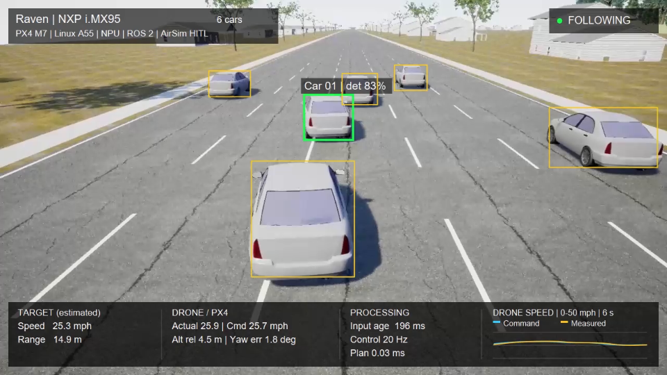

# Raven demos

Hardware-connected demonstrations of the Raven drone platform on **NXP FRDM-IMX95**.

[Build the platform](https://github.com/Swamy-BV/raven-manifest/tree/develop) | [Onboard software](https://github.com/Swamy-BV/meta-raven/tree/develop) | [Simulation scenarios](https://github.com/Swamy-BV/raven-simulation)

## Six-car tracking

The selected car moves through a six-car lane-shuffle scene. i.MX95 Linux runs
NPU detection, vehicle appearance matching, tracking and guidance. PX4/NuttX on
the actual Cortex-M7 controls the simulated aircraft through hardware-in-the-loop.
Windows AirSim supplies the scene, camera and simulated sensor data.

- **Onboard:** YOLOv8s detection and PP-LCNet vehicle embeddings on the Neutron
  NPU; ByteTrack association and ROS 2 guidance on the Cortex-A55.
- **Flight control:** M7 PX4 receives guidance over the onboard RPMsg DDS link.
- **Recording:** approximately 76 seconds, including a 61-second following test.

[Small MP4 preview (6.35 MB)](https://github.com/Swamy-BV/raven-demos/releases/download/showcase-2026-10-22/raven-six-car-tracking-preview.mp4) | [Full-quality MP4 (78.86 MB)](https://github.com/Swamy-BV/raven-demos/releases/download/showcase-2026-10-22/raven-six-car-tracking.mp4)

This demonstrates simulated flight with real onboard compute and flight control;
physical flight has not been qualified. GPS-denied VIO is a separate shadow-mode
evaluation and is not controlling this demo.

Videos are release assets, outside Git history. This repository contains only
the gallery, thumbnails and license. Raven-authored gallery content is licensed
under AGPL-3.0-only; third-party components retain their own licenses.
