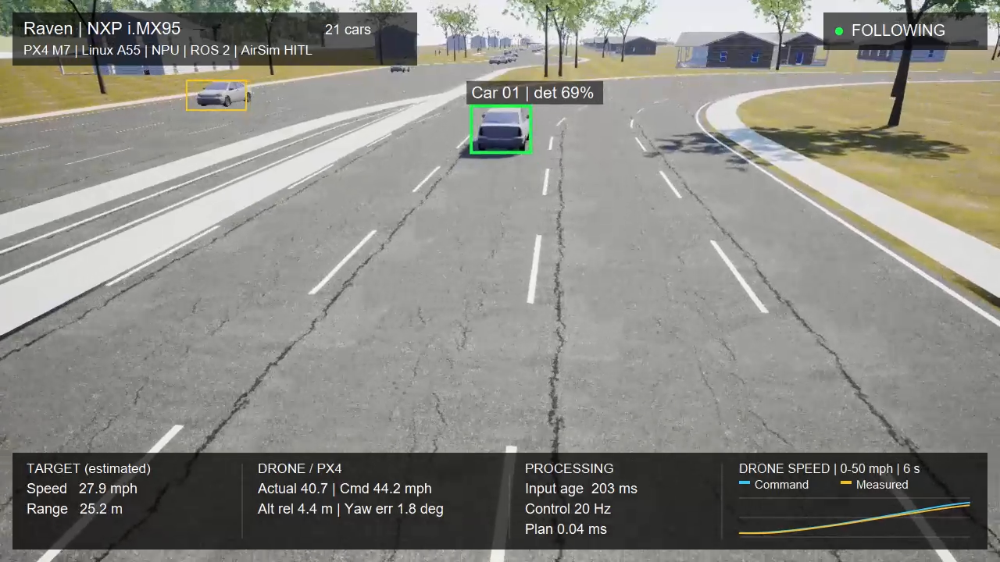

# Raven demos

Hardware-connected demonstrations of the Raven drone platform on **NXP FRDM-IMX95**.

[Build the platform](https://github.com/Swamy-BV/raven-manifest/tree/develop) | [Onboard software](https://github.com/Swamy-BV/meta-raven/tree/develop) | [Simulation scenarios](https://github.com/Swamy-BV/raven-simulation)

## City vehicle tracking

[Watch in your browser](https://swamy-bv.github.io/raven-demos/)

A selected car drives through city traffic, bends, intersections and roundabouts
among 21 vehicles. NXP i.MX95 Linux runs perception and guidance; Cortex-M7 PX4
controls the simulated AirSim aircraft. Windows supplies the scene, camera and
simulated sensors.

- **Onboard vision:** YOLOv8s detection and PP-LCNet vehicle embeddings on the
  Neutron NPU; ByteTrack tracking on the Cortex-A55.
- **Guidance:** ROS 2 target following with bounded prediction; setpoints and
  aircraft state travel over the onboard RPMsg DDS link to M7 PX4.
- **Scene:** 21 vehicles, crossing traffic, S-bends and two roundabouts. Target
  cruise speed is configured for 40 mph, with slower cornering.
- **Recording:** 2 minutes 39 seconds at 720p, including approximately 140 seconds
  of moving-target following. Overlays show recorded detections and flight data.

The three-minute test ended early: the drone overshot a slowing car, lost visual
tracking and entered the target-loss hold, followed by landing and disarming.
Braking, minimum stand-off and tight-turn speed control are the next improvements.
This is simulated flight with real onboard compute and flight control. Simulator
truth is evaluation only; VIO does not control this demo.

[720p MP4](https://github.com/Swamy-BV/raven-demos/releases/download/city-2026-10-23/raven-city-tracking-720p.mp4)

[Earlier five-bridge demo](https://github.com/Swamy-BV/raven-demos/releases/tag/bridges-2026-10-23)

Videos are release assets, outside Git history. This repository contains only
the gallery page, thumbnails and license. Raven-authored gallery content is licensed
under AGPL-3.0-only; third-party components retain their own licenses.
